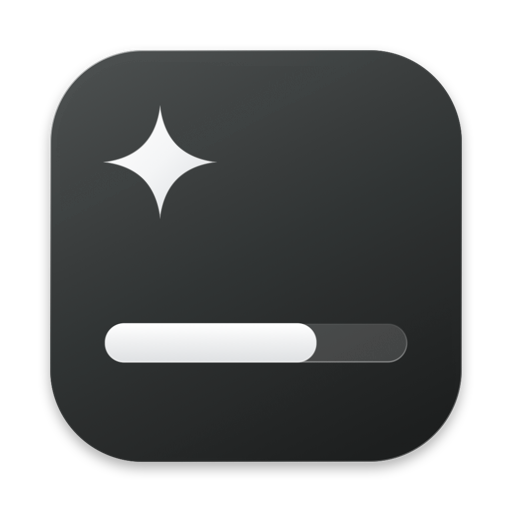

# TokenWidget

macOS 화면 위에 떠 있는 Claude / Codex 사용량 위젯.

- **5시간 / 주간** 남은 사용량(%)과 리셋까지 남은 시간 표시
- 카드 하나에서 Codex ↔ Claude 페이지 전환 (트랙패드 두 손가락 스와이프, 마우스로 좌우 쓸기, 아래 점 클릭)
- 윗부분(로고 줄)을 잡고 끌면 아무 데나 이동, 위치 기억
- 더블클릭 → 작게 보기 (5시간 막대만)
- 우클릭 → 새로고침 / 작게·크게 보기 / 항상 위에 표시 / 종료
- 1분마다 자동 새로고침

## 요구 사항

- macOS 14 이상
- Codex: [Codex CLI](https://github.com/openai/codex)를 한 번 이상 사용 (`~/.codex/sessions` 로그를 읽음)
- Claude: [Claude Code](https://claude.com/claude-code)에 로그인 (키체인의 `Claude Code-credentials` 토큰으로 사용량 조회)

## 빌드

```sh
git clone https://github.com/dh5831/TokenWidget.git
cd TokenWidget
./build.sh
open TokenWidget.app
```

Xcode Command Line Tools(`xcode-select --install`)만 있으면 됩니다.
로그인 시 자동 실행하려면 `TokenWidget.app`을 응용 프로그램 폴더로 옮긴 뒤 **시스템 설정 → 일반 → 로그인 항목**에 추가하세요.

## Windows

`windows/` 폴더에 같은 기능의 Electron 버전이 있습니다. Windows 10/11 x64용입니다.

```sh
cd windows
npm install
npm test
npm run dist
```

`windows/dist/TokenWidget-Setup-1.0.0.exe`를 실행하면 관리자 권한 없이 설치됩니다. macOS에서도 빌드할 수 있습니다. 코드 서명이 없어 처음 실행할 때 SmartScreen 경고가 뜰 수 있습니다.

macOS 버전과 다른 점:

- Claude 토큰은 `%USERPROFILE%\.claude\.credentials.json`에서 읽습니다.
- Codex 로그는 `%USERPROFILE%\.codex\sessions`에서 읽습니다.
- 배경 블러 대신 반투명한 어두운 카드로 표시합니다.
- 우클릭 메뉴에서 Windows 시작 시 자동 실행을 켤 수 있습니다.

## 데이터 출처

| | 출처 | 비고 |
|---|---|---|
| Codex | `~/.codex/sessions/**/*.jsonl`의 마지막 `rate_limits` | 마지막으로 Codex를 쓴 시점 기준 |
| Claude | `https://api.anthropic.com/api/oauth/usage` | 비공식 API라 바뀔 수 있음. "토큰 만료"가 뜨면 `claude`를 한 번 실행 |

토큰이나 사용량 정보는 외부로 전송하지 않으며, Claude 사용량 조회 요청만 Anthropic API로 보냅니다.
